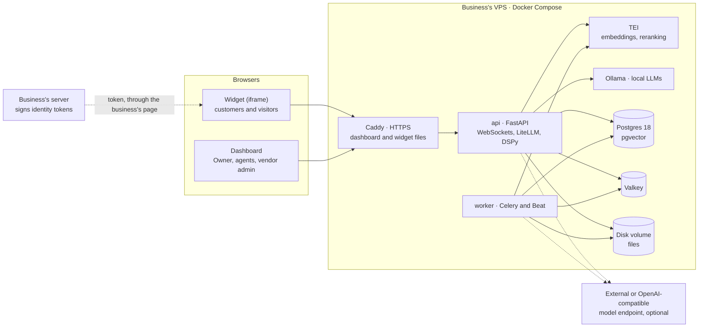

# Support Chatbot tech stack

What every V1 install runs, why each piece is there, and the rules for configuring it. The decisions are recorded in [ADR-0014](adr/0014-v1-tech-stack.md), amended by [ADR-0024](adr/0024-stack-review-corrections.md) and refined by [ADR-0025](adr/0025-cpu-classifier-fallbacks-and-uncalibrated-models.md); the API client is in [ADR-0026](adr/0026-typed-api-client-from-openapi.md), and the repository layout in [ADR-0027](adr/0027-repository-layout-and-git-workflow.md). If this page and an ADR disagree, the ADR wins. Requirements (IDs such as AI-8 or SEC-13) live in the [PRD](prd.md).

Updated 2026-10-06.

## At a glance

- **One install per business,** on the business's own VPS ([ADR-0006](adr/0006-one-install-per-business.md), [ADR-0009](adr/0009-vendor-installs-business-operates.md)).
- **Seven containers under Docker Compose.** Only Caddy is reachable from the internet.
- **Python 3.12 backend** (FastAPI, Celery) and **TypeScript frontend** (Next.js dashboard, Vite widget).
- **Postgres 18 with pgvector** holds everything durable. **Valkey** holds everything short-lived.
- **Models** run locally on CPU (Ollama, TEI), or through an external provider the Owner picks. No GPU is required ([ADR-0011](adr/0011-cpu-first-models.md)).
- **Operated by the vendor over SSH:** one-command upgrades with rollback, and daily encrypted backups ([ADR-0012](adr/0012-vendor-operates-every-install.md), [ADR-0013](adr/0013-upgrades-and-migrations.md)).

## Containers

**One install.** The business's server signs identity tokens; everything else runs on the business's VPS.



| Container | Software | Role | Reachable from |
| --- | --- | --- | --- |
| caddy | Caddy | HTTPS with automatic certificates; reverse proxy to the API; serves the dashboard's static files and the widget files | The internet: ports 80 and 443, the only published ports |
| api | FastAPI on uvicorn, Python 3.12 | REST API, WebSockets, sign-in, identity-token checks, AI turns (classify, retrieve, stream answers) | Caddy |
| worker | Celery worker with Celery Beat | Ingestion, web import, re-embedding, deletion purges, timed jobs | Internal network only |
| tei | Text Embeddings Inference, CPU image | Embeddings (`/embed`) and reranking (`/rerank`) for local models | Internal network only |
| ollama | Ollama | Local LLMs on CPU | Internal network only |
| postgres | `pgvector/pgvector:pg18` | All durable data: conversations, customers, knowledge, vectors, turn records | Internal network only |
| valkey | Valkey | Pub/sub between API processes, Celery broker, locks, rate-limit counters, caches | Internal network only |

TEI and Ollama are needed only for local models. On the host, outside the containers, run the server CLI and the cron job for daily backups.

## Backend

| Concern | Choice | Rules |
| --- | --- | --- |
| Language and packaging | Python 3.12, uv | Taken from the earlier projects |
| Web framework | FastAPI on uvicorn | Serves REST and WebSockets |
| Database access | SQLAlchemy | Async sessions in the API; synchronous sessions in Celery workers. Do not wrap async code inside workers. |
| Migrations | Alembic | Run once per upgrade, in a one-off container, never on application startup. Expand, then contract; no downgrade migrations ([ADR-0013](adr/0013-upgrades-and-migrations.md)). |
| Background jobs | Celery, with Valkey as the broker | Set the visibility timeout above the longest job measured in M0, or long jobs such as re-embedding run twice. |
| Timed jobs | Celery Beat, inside the worker container | Auto-resolve after 24 idle hours; close after 4 idle days; visitor cleanup after 9 months; knowledge reconciler every 15 minutes |
| Live delivery | FastAPI WebSockets; Valkey pub/sub between API processes | Clients send over HTTP and receive over the WebSocket (RT-1 to RT-8) |
| AI turns | Async tasks in the API process | One Valkey lock per conversation. 30 s timeout with external providers; the CPU value comes from M0. On shutdown, wait up to 30 s for running turns; unfinished turns hand off (AI-9). |
| Dashboard sign-in | Built into the app | Email and password, HTTP-only SameSite=Strict cookies, a CSRF token on every state-changing request, rate-limited attempts. Dashboard and API on one domain (D-1). |
| Customer identity | Short-lived JWT, signed by the business's server with the install's identity secret | Reject unsigned, wrongly signed or expired tokens; the secret can be rotated (ID-1, ID-7) |
| Widget sessions | Bearer token kept in the iframe's own storage | Never cookies: browsers block or partition them inside another company's site (ID-9) |
| Development tooling | ruff, mypy, pytest | Taken from `support-agent-platform` |

## AI and models

| Concern | Choice |
| --- | --- |
| Provider interface | The LiteLLM library. Every model call goes through it ([ADR-0001](adr/0001-model-providers-behind-one-interface.md)). |
| Answers | Generated and streamed through LiteLLM directly, not through DSPy. The server holds back the first 16 tokens to catch the abstain token. |
| Classification, full mode | A DSPy module with structured output: category, standalone query, language |
| Classification, CPU mode | An embedding-similarity check on TEI, or a small model; M0 picks. With the embedding check, follow-up questions, "yes" after an offer of a person, and canned-reply language follow fixed rules (AI-8, [ADR-0025](adr/0025-cpu-classifier-fallbacks-and-uncalibrated-models.md)). |
| Local LLMs | Ollama on CPU. M0 picks the default answer model, in the 4–7B class. |
| GPU hosts | Any OpenAI-compatible endpoint, such as vLLM, set in the model settings. No vLLM container ships. |
| External providers | Any provider LiteLLM supports, with the Owner's API key, stored encrypted |
| Embeddings and reranking | TEI, or an external API. First candidates are bge-m3 and bge-reranker-v2-m3; M0 confirms they run on TEI's CPU image. |
| Who picks models | The vendor sets each install's starting models; the Owner may change any of them, at their own risk ([ADR-0011](adr/0011-cpu-first-models.md)) |
| Relevance thresholds | Calibrated per model. An uncalibrated model gets no relevance cut-off and is marked "uncalibrated" in the dashboard ([ADR-0025](adr/0025-cpu-classifier-fallbacks-and-uncalibrated-models.md)). |

## Data

| Store | Holds | Rules |
| --- | --- | --- |
| Postgres 18 with pgvector | Everything durable; the logical data model is in the PRD | Embeddings as `halfvec`: one row per chunk per model, and one HNSW index per model. Refuse models above 4,000 dimensions. Full-text search uses the `simple` dictionary until per-language dictionaries arrive (KB-17). |
| Disk volume | Uploaded files and parsed text | Backed up together with the database |
| Valkey | Pub/sub events, Celery messages, locks, counters, caches | Eviction disabled (`noeviction`), as Celery requires |

pgvector indexes `halfvec` up to 4,000 dimensions. Rows of different sizes are indexed with a cast and a filter, one index per model ([pgvector](https://github.com/pgvector/pgvector)):

```sql
CREATE INDEX ON chunk_embeddings
  USING hnsw ((embedding::halfvec(1024)) halfvec_cosine_ops)
  WHERE model_id = 1;
```

Queries must repeat the same cast and filter, or Postgres will not use the index.

## Knowledge ingestion

| Input | Library | Notes |
| --- | --- | --- |
| PDF with a text layer | pdfplumber | Docling is the fallback if the M0 bake-off needs better tables or headings. PyMuPDF is excluded because it is AGPL. |
| DOCX | python-docx | |
| Markdown | markdown-it-py | |
| Plain text | Python standard library | |
| Web pages | Our own crawler on httpx, plus trafilatura | All fetching goes through the guarded HTTP client; trafilatura only extracts the main text. Static HTML only; refreshed manually ([ADR-0019](adr/0019-web-pages-as-knowledge.md)). |

**The guarded HTTP client** (SEC-13) is the only way the install fetches the web:

- It allows http and https only.
- It resolves DNS and refuses private, loopback, link-local and internal-network addresses, both before connecting and on every redirect.
- It caps response size and fetch time.

## Frontend

| Part | Choice | Notes |
| --- | --- | --- |
| Dashboard | Next.js, React, TypeScript, Tailwind, exported as static files | Served by Caddy; English only. Pages call the API from the browser, with no server rendering, middleware or server actions. |
| Widget loader | Plain TypeScript bundle, ≤ 10 KB gzipped | Loads async and injects the launcher and the iframe. The bundler is engineering's choice. |
| Widget chat app | React and TypeScript, built with Vite | English, French and Arabic, with a right-to-left layout for Arabic (W-4). Authenticates with a bearer token. The CSS approach and translation library are engineering's choice. |
| API client | Generated by Hey API's openapi-ts from FastAPI's OpenAPI spec, with TanStack Query options and keys. WebSocket event types are generated from their Pydantic models. | Used by the dashboard and the widget chat app. CI regenerates both and fails on any difference ([ADR-0026](adr/0026-typed-api-client-from-openapi.md)). |

## How the pieces work together

**A customer's message**

1. The widget sends the message through Caddy to the API, with its bearer token.
2. The API stores it in Postgres and publishes it on Valkey. Every API process forwards it to open dashboards over WebSockets.
3. The API classifies it: through DSPy and LiteLLM in full mode, or on TEI in CPU mode. It then embeds the search query, searches Postgres (pgvector plus full text), and reranks the results.
4. The API streams the answer from the chosen model through LiteLLM. Deltas travel through Valkey to the customer's WebSocket. The final message and the turn record are written to Postgres.

**A document**

1. The dashboard uploads the file through Caddy to the API. The API stores it on the disk volume and queues a Celery task in Valkey.
2. The worker parses, chunks and embeds it, then writes the chunks and vectors to Postgres. The new status reaches the dashboard over WebSockets.

## Security configuration

- Only Caddy publishes ports. Ollama, TEI, Postgres and Valkey listen on the internal Docker network only (SEC-14).
- TLS comes from Caddy's automatic certificates (SEC-8).
- The identity secret and provider API keys are encrypted in Postgres. The encryption key sits in the server's environment file, readable only by the service account (SEC-6).
- Web import fetches only through the guarded HTTP client (SEC-13).
- Logs carry IDs, never message or document text (SEC-10).
- Nothing is sent to the vendor. External providers receive conversation text and knowledge excerpts only when the Owner chooses one (SEC-9).

## Operations

| Concern | Choice |
| --- | --- |
| Source | One private GitHub repository, with a root per toolchain: `backend/`, `frontend/`, `deploy/`, `bench/` and `docs/`. Short-lived branches, squash-merged into `main` by pull request ([ADR-0027](adr/0027-repository-layout-and-git-workflow.md)). |
| Releases | A `vX.Y.Z` tag on `main` builds every image and the install bundle under one version ([ADR-0027](adr/0027-repository-layout-and-git-workflow.md)) |
| Packaging | Docker images pinned by version, run with Docker Compose |
| Registry | GitHub Container Registry, private, with a read-only token per install |
| Install | The vendor installs from a versioned bundle: the Compose file, an environment template and the server CLI |
| Upgrade | `upgrade <version>`: check, back up, pull, migrate once, restart, verify, and roll back on failure ([ADR-0013](adr/0013-upgrades-and-migrations.md)) |
| Backups | The host's cron runs `backup` daily: a database dump plus the stored files, encrypted by restic and sent to an off-server repository (destination still open) |
| Health | A health check on every container, a `status` command, and the vendor's external uptime check on each install's health endpoint |
| AI report | `report` prints the weekly figures from the turn records |
| Logs | Structured JSON. Docker log size and file count are capped in the Compose file, so logs cannot fill the disk. |
| CI | Lint, type checks and tests; an upgrade test from the previous release's database; dependency and image scanning; a check that the generated API client and event types are up to date |

Server CLI commands: `install`, `upgrade <version>`, `backup`, `restore`, `status`, `report`, `reset-password`.

## Observability

- **Turn records** (`ai_turns`) in Postgres hold each turn's category, search query, chunks and scores, models, prompt version, tokens, latencies and outcome.
- **Structured logs** carry request and turn IDs.
- **No metrics stack** runs on the VPS: no Prometheus, no Grafana. A stats page for the vendor admin is P1.

## Decided by the M0 benchmark

These depend on OneClickDZ's VPS, whose specs are still unknown, so they are measured rather than guessed.

| Decision | Settled by |
| --- | --- |
| CPU latency targets for first token and canned replies | Timing the whole pipeline on the VPS |
| Classifier mode: embedding check or small model | Accuracy and speed on English, French, Arabic and Darija samples |
| Default local answer, embedding and rerank models | Quality, speed, memory, license, and TEI compatibility |
| Prompt budgets for CPU installs | Meeting the CPU latency targets |
| Celery visibility timeout | The longest job, usually re-embedding |
| Minimum CPU, RAM and disk; recommended VPS | Peak memory with the whole stack running together |
| PDF parser: pdfplumber or Docling | A bake-off on real documents |

## Not in the stack

| Left out | From | Replaced by | Why |
| --- | --- | --- | --- |
| Kubernetes | Architecture diagram | Docker Compose | One VPS per business, operated by one person |
| Neon OSS branching | Architecture diagram | Postgres 18 | One business per install leaves branches no job, and Neon ships no production control plane for self-hosting |
| Keycloak | Architecture diagram | Sign-in built into the app | A handful of users per install; saves a Java service and its database |
| Centrifugo | Architecture diagram | FastAPI WebSockets with Valkey pub/sub | Small scale per install |
| LiteLLM proxy | Architecture diagram | LiteLLM library | One less service |
| MinIO | Architecture diagram | Disk volume | One server per install; MinIO's repository is no longer maintained |
| Prometheus, Grafana, OpenTelemetry | Architecture diagram | Turn records, logs, `report` | No metrics stack on a small VPS |
| vLLM container | Architecture diagram | Any OpenAI-compatible endpoint | No install has a GPU yet |
| BGE-M3 as the fixed embedding model | Architecture diagram | The Owner's choice, defaults from M0 | Embedding model chosen per install ([ADR-0002](adr/0002-embedding-model-per-workspace.md)) |
| Custom sentence-transformers service | First stack proposal | TEI | No embedding server to write and maintain |
| Redis | Earlier projects | Valkey | BSD license, drop-in replacement |
| Next.js server | First stack proposal | Static export | No Node container |
| Qdrant | `ai-support-api` | pgvector | One less service |
| Langfuse | `ai-support-api` | Turn records | Its self-hosted setup added six containers |
| oRPC | Considered 2026-10-06 | Hey API client generated from FastAPI's spec | Built for TypeScript servers; with a Python API it would only add an experimental layer on a generated client ([ADR-0026](adr/0026-typed-api-client-from-openapi.md)) |

## Licenses

The product is proprietary ([ADR-0010](adr/0010-proprietary-closed-source.md)), so every shipped component needs a license that allows that. Licenses as of October 2026; re-check them when upgrading a dependency.

| Component | License |
| --- | --- |
| FastAPI, SQLAlchemy, Alembic, Pydantic, DSPy | MIT |
| LiteLLM | MIT, except its separately licensed enterprise directory |
| Uvicorn, httpx, Celery, Valkey | BSD-3-Clause |
| pdfplumber, python-docx, markdown-it-py, Docling | MIT |
| trafilatura | Apache-2.0 (from version 1.8.0) |
| PostgreSQL, pgvector | PostgreSQL License |
| Ollama | MIT |
| Text Embeddings Inference, Caddy | Apache-2.0 |
| Next.js, React, Vite, Tailwind CSS, Hey API openapi-ts | MIT |
| restic | BSD-2-Clause |
| Docker Engine (Moby), Docker Compose | Apache-2.0 |
| PyMuPDF | AGPL-3.0, so excluded |

Model weights carry their own licenses. Check each M0 candidate; Llama's community license, for example, restricts use.
